# pixelate-anything

**Hand-crafted pixel art for AI agents.**

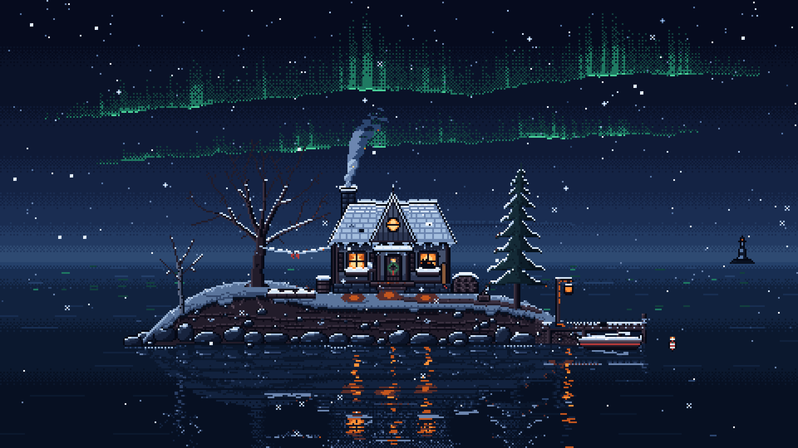

*Lantern Isle in winter, one season of a seamless four-season loop with its own lofi soundtrack. Every pixel, the aurora, the snowfall and the lamplight on the water are drawn in code by the kit.*

<!-- library gallery: generated start -->
## Library gallery

### The Canyon That Moves Without Moving (`canyon-cycle`)

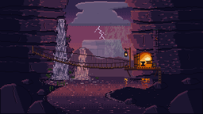

A gorge where two waterfalls meet, with a rope bridge, a forge and a mesa under storm clouds, decoded from one index array: A rose sunset at the lightning instant, B indigo night. **Declared status:** `study` (not an art or rights certificate).

**Request:** one 320x180 still of a gorge at the meeting of two waterfalls: a rope bridge, a forge cut into the cliff with its door open, a river curling into the foreground, a hanging lantern, storm clouds over a far mesa. No pixel is ever redrawn: all motion is palette rotation over dedicated slot ranges. The palette moves through four moods: cold dawn, hard white noon, rose sunset, indigo night. Deliver two moments from one index array: A rose sunset at the lightning instant, B indigo night.

`pixelate remix canyon-cycle work/YOUR-NAME --request "YOUR REQUEST"`

### The Endless Ascent (`endless-ascent`)

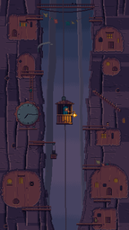

A gondola with one lantern-holding passenger climbs a giant trunk: A it passes the clock of a town carved into the trunk, B it rises out of a cloud sea under the aurora. **Declared status:** `study` (not an art or rights certificate).

**Request:** a vertical 270x480 lofi loop \(delivered 4x, 1080x1920\): a small gondola with one lantern-holding passenger stays fixed at the screen centre while a 1200 px world strip \(root caverns, trunk town, cloud sea, thin air\) scrolls down past it forever. This brief covers the two showcase stills and a 5 s sound sample.

`pixelate remix endless-ascent work/YOUR-NAME --request "YOUR REQUEST"`

### One Morning, Four Machines (`four-machines`)

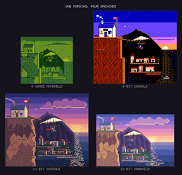

One moment drawn four times under four console limits: a postmaster launches a mail glider off a cliff-top post office at sunrise over a waking fishing town, as Game Boy-, NES-, SNES- and GBA-style panels. **Declared status:** `study` (not an art or rights certificate).

**Request:** No verbatim user request is recorded for this piece. The brief \(brief.md section 0\) states the intent: "one original moment drawn four times, each time designed for its machine, so the comparison itself is the delight" and the moment: "a young postmaster launches a canvas mail-glider off the rail of a cliff-top post office at sunrise ... below, a fishing town in a cove is waking", under Game Boy-, NES-, SNES- and GBA-style limits, with an original 8-bar 116 bpm lift-off theme.

`pixelate remix four-machines work/YOUR-NAME --request "YOUR REQUEST"`

### Lantern Isle (`lantern-isle`)

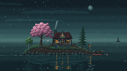

A small island cottage in a calm night sea, looping through four seasons with its own generative lofi soundtrack. **Declared status:** `study` (not an art or rights certificate).

**Request:** Make an animated pixel-art diorama of a small island in a calm sea, built to be the looping cover for a 10-hour lofi music video, with its own generative lofi soundtrack that changes with the seasons. Art direction: It must look hand-pixeled by a skilled artist, at the quality of hand-crafted indie game key art, with no AI or procedural feel. - Draw every object as a hand-authored sprite \(pixel maps defined in code\), not shapes built from circles, rectangles, or math curves. - Use a strict limited palette per season and manual pixel techniques: selective anti-aliasing, clean pixel clusters, no stray single pixels, no pillow shading, no smooth gradients. Use dithering only where it adds texture, such as in the sky and water. - Give careful silhouettes so every shape reads clearly, and use soft rim lighting where warm light hits cool surfaces. Favor restraint and atmosphere over clutter. - Avoid symmetry and perfection. Trees lean slightly, the roof sags a little, shutters don't match, the dock has a missing plank, rocks have uneven edges. - Animate with stepped, frame-by-frame timing \(3 to 6 frame cycles at about 8 to 12 fps for flames, leaves, and water\) instead of smooth interpolation. Motion should feel drawn, not simulated. - Hand-place particles and vary them: petals, leaves, and snowflakes use several small sprite variants with irregular paths, not uniform random sprays. - No glow blur, bloom, lens effects, or soft shadows. Express light with color shifts and a few deliberate highlight pixels. - Add lived-in storytelling details: a worn path to the door, a patched roof tile, firewood stacked by the wall, a laundry line, a cat sleeping on the windowsill, a mug on the porch rail, and small items that change with each season. - Keep a consistent pixel scale everywhere; nothing drawn at a different resolution. Scene: A fixed, centered side-on view of one small island with a cozy cottage \(chimney, glowing windows, small porch\), two or three trees, a little dock with a rowboat, a lantern post, and a garden patch. Gentle waves lap the shore, and the sea reflects the sky and the window light. The island fills roughly the middle 60% of the frame. Seasons: The scene cycles through spring, summer, fall, and winter, about 90 seconds each, with soft 10-second crossfades in both visuals and music. Winter blends back into spring so the cycle loops seamlessly. All seasons are set at twilight or night so the warm cottage glow always contrasts with a cool sky and sea. - Spring Palette: misty teal, sage green, blossom pink, warm amber windows. Elements: soft rain, cherry blossoms, falling petals, a puddle shimmer on the dock, a small kite tied to the porch. Music: Fmaj7 / Em7 / Dm7 / Cmaj7, light Rhodes piano, gentle rain ambience, around 72 BPM. - Summer Palette: deep indigo sky, magenta-orange horizon, lush green, golden lantern light. Elements: fireflies, full canopy, a hammock between trees, sparkles on the water, a distant lighthouse beam sweeping the sea. Music: Dmaj9 / Bm7 / Gmaj7 / A6, warm guitar, soft cicadas and waves, around 78 BPM. - Fall Palette: dusky violet, burnt orange, rust red, honey-yellow windows. Elements: drifting red and orange leaves, chimney smoke, low mist on the sea, pumpkins on the porch, a few migrating birds crossing the sky. Music: Am9 / Fmaj7 / Dm9 / E7, muted piano, wind and rustling leaves, around 70 BPM. - Winter Palette: cold navy, icy blue, snow white, deep fire orange. Elements: falling snow, snow on the roof and trees, icicles on the eaves, frost on the shore, a bright fireplace glow, faint aurora in the sky. Music: Cmaj7 / Am7 / Fmaj7 / G6, sparse music box and pad, crackling fire, around 66 BPM. Music: Generate the lofi soundtrack procedurally with the Web Audio API: soft drums with swing, a warm bass, the seasonal chord progression and instrument, light vinyl crackle, and seasonal ambience. Add small random variations in melody and drum fills so it doesn't feel repetitive over hours. Start audio on a single click \(browsers require it\) with a clean play button that hides afterward. Motion: Keep everything slow and calm. Subtle ambient effects throughout: flickering window light, drifting smoke, swaying trees, rippling water, and the seasonal particles. No sudden movement, no text, no people. Technical: Render at a native 480x270 pixel canvas, scaled 4x with nearest-neighbor to a crisp 1920x1080. Run at a steady frame rate and loop smoothly for hours without drift, audio glitches, or visible seams. Deliver it as a single self-contained HTML page with a canvas.

`pixelate remix lantern-isle work/YOUR-NAME --request "YOUR REQUEST"`

### Lanternmoss Mire (`lanternmoss-mire`)

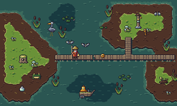

A 16x16 tile and sprite asset pack for a bog \(tiles, a bog-ferrier hero, six creatures, items, props\), shown as its 320x192 map: A by day, B the same tiles at night, glowing. **Declared status:** `study` (not an art or rights certificate).

**Request:** No verbatim user request is recorded for this piece. The brief \(brief.md section 0\) states: "assets \(guides/assets.md\) ... 16x16 tiles; hero 16x24 ... creatures 12-20 px; items 7-12 px", a 3/4 top-down game screen, day and glowing night palettes, a 320x192 map at 4x, and a 5.0 s SFX reel \(examples/moments/README.md: "A: the asset pack's map by day. B: the same tiles at night, glowing."\).

`pixelate remix lanternmoss-mire work/YOUR-NAME --request "YOUR REQUEST"`

### Market Day, From the Bell Tower (`market-day`)

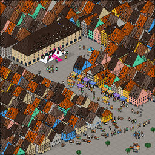

Strasbourg's old-town street and squares at noon, rebuilt after an aerial photo and full of market stories: A the whole frame, B the wedding on the hall steps at 8x. **Declared status:** `study` (not an art or rights certificate).

**Request:** rebuild Pexels photo 14037897 \(Nick Verlice, "Aerial View of Medieval Buildings on an Old Town": Strasbourg's Rue Merciere seen from the cathedral tower\) as sticker-iso at 600x600, delivered 4x at 2400x2400; a market day with a wedding on the hall steps as the hero; a 5 s brass-band sound sample.

`pixelate remix market-day work/YOUR-NAME --request "YOUR REQUEST"`

### Meadow Kit (`meadow-kit`)

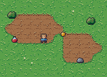

A complete asset pack: a 16x16 hero with idle and walk animations, items, props, an autotiling grass-and-dirt set, animated water and a sample map. **Declared status:** `study` (not an art or rights certificate).

**Request:** Unknown: the original request was not recorded in the repository. First-party sample pack from the initial kit commit; guides/assets.md describes it as a complete pack. Source description: Meadow Kit: hero, items, an autotile set and a map.

`pixelate remix meadow-kit work/YOUR-NAME --request "YOUR REQUEST"`

### Monsoon Street, After Hours (`monsoon-street`)

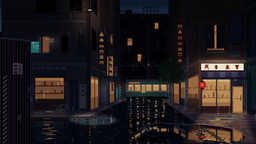

A one-point-perspective shopping street rebuilt after a photo: A the tram crosses the vanishing point in a downpour, B at 2 a.m. the puddle mirrors the street. **Declared status:** `study` (not an art or rights certificate).

**Request:** rebuild Pexels 18867525 \(a one-point-perspective shopping street after rain\) as a dim blue-hour / night street in its own camera, cosy-lightmap \`--scene exterior\`, 480x270 at 4x. Two stills of the best moments \(A "Downpour: the tram crosses", B "2 a.m.: the mirror"\) and a 5 s lofi sample of the downpour phase.

`pixelate remix monsoon-street work/YOUR-NAME --request "YOUR REQUEST"`

### Projections (`projections`)

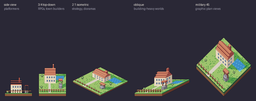

One little scene \(a cottage, a tree, a well, a pond, a fence\) rendered from a single 3D description in the five projections pixel art uses: side, 3/4 top-down, 2:1 isometric, oblique and military. **Declared status:** `study` (not an art or rights certificate).

**Request:** Unknown: the original request was not recorded in the repository. Guides/rebuild.md and guides/styles.md use it as the worked example of the five projections. Source description: one scene in the five projections pixel art uses.

`pixelate remix projections work/YOUR-NAME --request "YOUR REQUEST"`

### The Quarry Wakes (`quarry-wakes`)

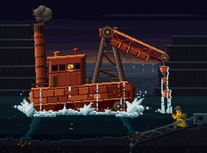

A colossal rusted dredging machine claws up out of a flooded quarry at dusk while a soldier in a mustard coat crouches behind a toppled crane: A it rises, B its leg slams the rim. **Declared status:** `study` (not an art or rights certificate).

**Request:** arcade style at 304x224, delivered 4x, checked one layer at a time against the neogeo era. A 6-second boss reveal for an invented game: a colossal rusted dredging machine claws up out of a flooded quarry at dusk \(bucket-chain jaw, piston legs, a cabin with one cracked lit window, moss in its seams\); a soldier in a mustard coat crouches behind a toppled crane on the right. Two stills of its best moments and a 5 s FM sting.

`pixelate remix quarry-wakes work/YOUR-NAME --request "YOUR REQUEST"`

### Retro Screens (`retro-screens`)

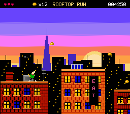

Three classic-genre screens under console-era limits: an 8-bit rooftop platformer, a Game Boy-style village RPG and an 8-bit title screen whose city is the san-francisco rebuild \(from a user-attested Pexels reference not included here\). **Declared status:** `study` (not an art or rights certificate).

**Request:** Unknown: the original request was not recorded in the repository. SOURCES notes describe the characters, places, titles and text as original; console names describe hardware limits only. The Pixel Harbor city behind the title screen is the san-francisco rebuild, made from a user-supplied Pexels photo not included in the repository. Source description: original classic-genre screens under console-era limits: an 8-bit platformer, a Game Boy-style RPG, an 8-bit title screen.

`pixelate remix retro-screens work/YOUR-NAME --request "YOUR REQUEST"`

### Rose Squall (`rose-squall`)

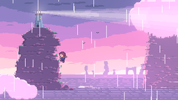

A courier clings to a sea stack under a lighthouse in a rose-coloured squall at dusk: a 120-frame pastel platformer loop with a turning beam, rain, waves and one lightning fork. **Declared status:** `study` (not an art or rights certificate).

**Request:** Unknown: the original request was not recorded in the repository. The commit message describes it as "a lighthouse on a sea stack in a rose squall \(pastel platformer style\)"; it studies the modern pastel platformer grammar, never its characters or places. Source description: original scenes that learn from modern indie pixel art: each one rebuilds a style's grammar \(palette, light regime, shapes, motion\) in code, never its characters or places.

`pixelate remix rose-squall work/YOUR-NAME --request "YOUR REQUEST"`

### San Francisco (`san-francisco`)

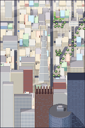

An aerial photo of the Financial District rebuilt twice: in its own 3/4 top-down camera and as a 2:1 isometric diorama that turns from day to dusk to night. **Declared status:** `study` (not an art or rights certificate).

**Request:** Unknown: the original request was not recorded in the repository. The user supplied an aerial photo of the Financial District and the Transamerica Pyramid from Pexels; the photo is not in the repository. Source description: the aerial photo rebuilt in its own 3/4 top-down camera, and as a 2:1 isometric diorama; day to dusk to night.

`pixelate remix san-francisco work/YOUR-NAME --request "YOUR REQUEST"`

### Santorini (`santorini`)

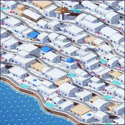

A cliffside Cycladic village rebuilt as a 2:1 isometric diorama from an aerial photo: white cubes on terraces, plunge pools, a blue-domed chapel and a windmill, from day through golden sunset to blue hour. **Declared status:** `study` (not an art or rights certificate).

**Request:** Unknown: the original request was not recorded in the repository. The reference is "Houses on Hill" by Vasilis Karkalas, https://www.pexels.com/photo/houses-on-hill-11222833/ \(Pexels license\); it is not in the repository. Source description: a cliffside village rebuilt as a 2:1 isometric diorama from a Pexels aerial; day, golden sunset, blue hour.

`pixelate remix santorini work/YOUR-NAME --request "YOUR REQUEST"`

### Starter: Assets (`starter-assets`)

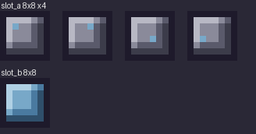

A neutral asset pack to copy: a grey-and-blue palette and two named placeholder slots \(a four-frame one with a moving marker pixel and a static one\) exported as strips, Aseprite-style JSON, an atlas and a contact sheet. It draws no subject of its own. One knob, scale \(8 or 4; default 8, as pack.json\), sets the export scale of the contact sheet and the scaled strips; the atlas stays 1x. **Declared status:** `starter` (not an art or rights certificate).

**Request:** Unknown: the original request was not recorded in the repository. Template from the initial kit commit; no request exists. Source description: My Pack. The coin and heart were replaced by neutral placeholder slots in the starter-empty follow-up.

`pixelate remix starter-assets work/YOUR-NAME --request "YOUR REQUEST"`

### Starter: Era NES (`starter-era-nes`)

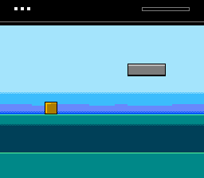

A neutral NES-style screen to copy, built like the hardware builds one: a nametable of 8x8 tiles, an attribute table of 16x16 sub-palette blocks over a shared backdrop, and a short sprite list, all in 2C02 master-palette colours. Placeholders only \(a status bar, a plain sky with a dithered band, a flat far strip, flat ground, a foreground strip, one platform, one 16x16 marker sprite\); its frame passes \`pixelate check --era nes\`. **Declared status:** `starter` (not an art or rights certificate).

**Request:** No user request: a new starter planned in docs/PLAN-library.md section 6.2 \(\`starter-era-nes\`, script runtime, status starter\): an empty piece for the era mode, held to the NES limits, that renders and passes the gate empty.

`pixelate remix starter-era-nes work/YOUR-NAME --request "YOUR REQUEST"`

### Starter: Music (`starter-music`)


A neutral music scaffold to copy: two plain generative phases \(a pulse-wave one and a pad-and-drone one\) with a generic hand-off each way, over a twelve-band pixel equaliser. No tune or story is written out; its first frame passes the lofi frame gate and its 48 s loop passes the music loop gate. **Declared status:** `starter` (not an art or rights certificate).

**Request:** Unknown: the original request was not recorded in the repository. Template from the initial kit commit; no request exists. Source description: Pixel Radio: a music-first template. The chiptune overworld theme and ambient drift were replaced by a generic two-phase scaffold in the starter-empty follow-up.

`pixelate remix starter-music work/YOUR-NAME --request "YOUR REQUEST"`

### Starter: Rebuild Perspective (`starter-rebuild-perspective`)

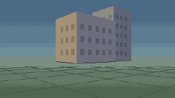

A neutral two-point perspective scaffold to copy for a rebuild: an upright pinhole camera set from a horizon row and two finite vanishing points, so every receding edge is a projected world line. Placeholders only \(two plain blocks with panel grids seen across their corners, a ground plane with paving joints, a plain sky\); its frame passes the lofi frame gate. **Declared status:** `starter` (not an art or rights certificate).

**Request:** No user request: a new starter planned in docs/PLAN-library.md section 6.2 \(\`starter-rebuild-perspective\`, script runtime, status starter\): an empty piece for the rebuild mode, in two-point perspective rather than an isometric preset, that renders and passes the gate empty.

`pixelate remix starter-rebuild-perspective work/YOUR-NAME --request "YOUR REQUEST"`

### Starter: Scene Loop (`starter-scene-loop`)

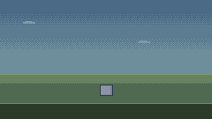

A neutral looping scene to copy: a sky over flat ground with placeholder shapes \(a grey box, a drifting block, a pulsing marker, a few night motes\) across a day and a night phase, with a lofi soundtrack. It draws no subject of its own; its day frame \(the first picture\) and its night frame pass the lofi frame gate. One knob, horizon \(80, 84 or 88; default 84, the golden frames\), sets the row where the ground begins. **Declared status:** `starter` (not an art or rights certificate).

**Request:** Unknown: the original request was not recorded in the repository. Template from the first kit commits; no request exists. Source description: Hilltop Cabin: a starter scene for pixelate-anything. The cabin, pine and rain were replaced by neutral placeholders in the starter-empty follow-up.

`pixelate remix starter-scene-loop work/YOUR-NAME --request "YOUR REQUEST"`

### Starter: Scene Still (`starter-scene-still`)

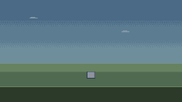

A neutral still scene to copy: a plain sky over flat ground with placeholder shapes \(a grey box with a marker, two flat blocks, a foreground strip\), rendered once by a small Python program. It draws no subject of its own; its one frame passes the lofi frame gate. **Declared status:** `starter` (not an art or rights certificate).

**Request:** No user request: a new starter planned in docs/PLAN-library.md section 6.2 \(\`starter-scene-still\`, script runtime, status starter\): an empty piece for the scene mode that renders a still and passes the gate empty.

`pixelate remix starter-scene-still work/YOUR-NAME --request "YOUR REQUEST"`

### The Tide Road Procession (`tide-procession`)

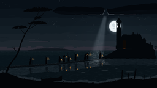

A tidal island monastery as a black silhouette against a low moon: A nine lanterns cross the causeway, B the monastery door opens and spills light down the steps. **Declared status:** `study` (not an art or rights certificate).

**Request:** a tidal island monastery as a flat black silhouette against a low moon \(the peak value\); one shaft from a cloud gap above the moon breathing across the water; a stone causeway to the near shore; the tide is the clock of a 96 s loop; nine lantern pilgrims cross; the door opens and spills light down the steps; the tide floods back. Two stills of the best moments and a 5 s sound sample.

`pixelate remix tide-procession work/YOUR-NAME --request "YOUR REQUEST"`

### Signal from Tidewater (`tidewater-signal`)

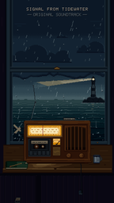

A cassette J-card cover: a lighthouse keeper's radio on a windowsill with its amber dial the only warm light in a storm night, A the radio in the storm, B the lightning frame. **Declared status:** `study` (not an art or rights certificate).

**Request:** a five-cue original soundtrack for an invented coastal adventure game, one 5-note leitmotif in every cue, and a 270x480 lofi cassette J-card cover: a lighthouse keeper's radio on a windowsill with the storm outside; the tape spools and VU needle animate in a short loop. This brief covers the two cover stills \(the best moments\) and the 5 s overworld sample.

`pixelate remix tidewater-signal work/YOUR-NAME --request "YOUR REQUEST"`

### Turntable Shipyard (`turntable-shipyard`)

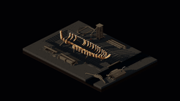

A tactics-style canal boatyard diorama floating in darkness, turned like a model on a lazy susan: A dawn with bare ribs on the keel, B night with the finished ship a quarter-turn later. **Declared status:** `study` (not an art or rights certificate).

**Request:** a tactics-style canal boatyard diorama floating in darkness, built once in tools/iso.py and tools/sdf.py and turned like a model on a lazy susan: four quarter-turns, each advancing time and construction \(bare ribs at dawn, planked hull at noon, deck and rails at dusk, mast and pennants at night with lanterns lit\). Two stills of the best moments and a 5 s work-song sample.

`pixelate remix turntable-shipyard work/YOUR-NAME --request "YOUR REQUEST"`
<!-- library gallery: generated end -->

The [static gallery page](docs/gallery/index.html) and these cards are generated from `library/index.json`. Cards report declared status, not an independent art grade or rights audit. Generation reads capped image bytes but neither decodes them nor runs piece code.

It ships three ways:
- **An agent skill** (`SKILL.md`), which carries the craft.
- **A CLI** (`pixelate`), which does the work.
- **An MCP server**, so any MCP client can use the same tools, with previews returned as images the agent can look at.

**Rebuild, don't convert.** Give it a photo of a place, and the agent does what a pixel artist would:
- keeps the photo's composition and camera,
- reads the place's shape language,
- keeps the reference's perspective when it matters, or chooses a stylized projection,
- picks the palette,
- adds the life the photo doesn't have.

| San Francisco, in the photo's own 3/4 camera | the same blocks, isometric | Santorini, from a Pexels aerial |
|---|---|---|
|  | 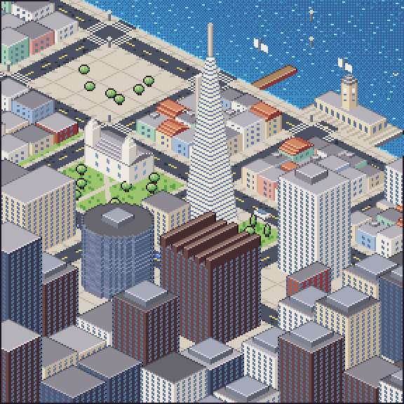 | 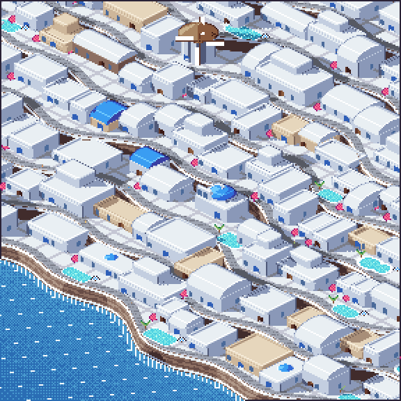 |

**Classic genres, original games.** Console-era presets (8-bit NES-style, Game Boy-style, 16-bit) hold art to the hardware's limits and check it.

| Rooftop Run, an 8-bit platformer screen | Island Village, Game Boy-style | Pixel Harbor, a title screen from the iso city |
|---|---|---|
|  | 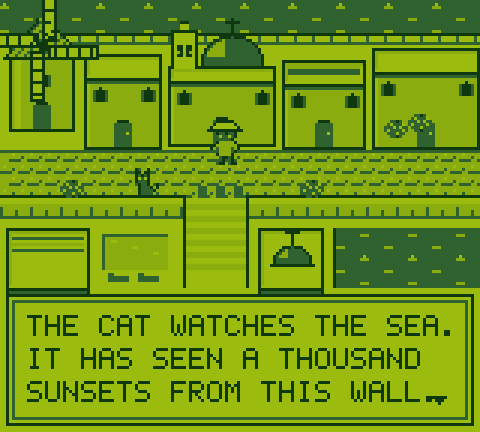 | 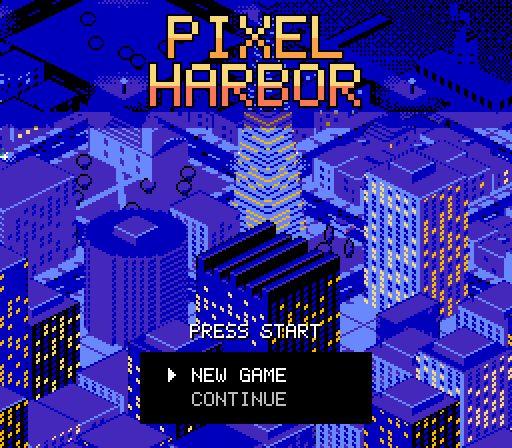 |


**Scenes that loop forever.** Lantern Isle turns through four seasons with its own generative lofi soundtrack, as a seamless 1080p or 4K video.

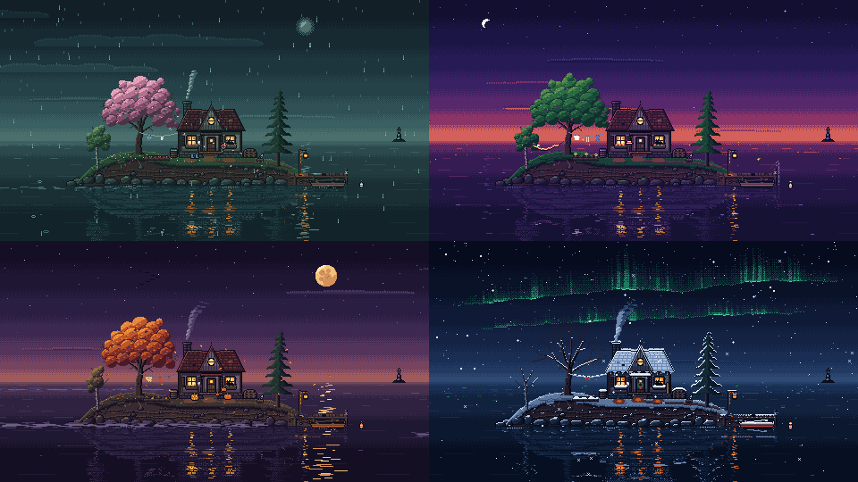

| mode | what you get |
|---|---|
| **Rebuild** | a photo of a place rebuilt with its camera or one of five orthographic presets (side, 3/4 top-down, 2:1 iso, oblique, military). Vanishing-point views are drawn on the native-pixel canvas; the orthographic renderer handles boxes and curved solids (rounded boxes, vaults, domes, arches, terrain), cast shadows, palette swaps from day to night, and palette-cycled water |
| **Eras** | original screens under real console limits: 8-bit NES-style (master palette, 4-colour blocks, 3-colour sprites), Game Boy-style 4 shades, 16-bit; a checker, retargeting, pixel fonts for HUDs and dialogue, including Chinese and Japanese |
| **Convert** | a quick mode for logos, screenshots and bold photos: palette fitting, majority sampling, despeckle, flattening, grading, cut-out sprites with outlines |
| **Palettes** | hue-shifted ramps from a few base colours, extraction from references, presets, and export to Aseprite/GIMP/hex/JSON/PNG |
| **Assets** | sprites, characters with animations, items, corner autotiles with variants, and tilemaps, exported as PNG strips with Aseprite-style JSON, an atlas, GIFs, contact sheets and silhouette checks |
| **Scenes and loops** | pixel scenes that move through moods (seasons, dusk and rain, ...), exported as a live HTML page, a seamless 1080p/4K MP4, a GIF or stills |
| **Music** | generative lofi, chiptune (NES-style pulse, triangle and noise) and ambient, which follows a scene or stands alone as seamless game loops (OGG/WAV) |


## Install

```sh
git clone https://github.com/huiskylabs/pixelate-anything
cd pixelate-anything
pip install -r requirements.txt     # pins the Pillow, NumPy and SciPy versions used for the goldens
./pixelate doctor                   # shows what each mode needs (node for scenes, ffmpeg for video)
./pixelate setup                    # registers the MCP server and the skill with your agents (asks first)
```

The library's Python art and audio include SciPy programs; these pins match the environment used to verify the checked-in 1× goldens, but cross-platform equality still needs a render test. Scenes need Node.js, and music/page renders also need Playwright's Chromium browser (`python3 -m playwright install chromium`); `pixelate doctor` checks these separately. The library's quick test skips audio on image pieces and does not certify music playback.

`setup` covers:
- **Claude Code:** the MCP server, plus the skill in `~/.claude/skills`.
- **Cursor, Codex and Gemini CLI:** the MCP server.

It shows its plan, asks before changing anything, and backs up every file it edits. For any other MCP client, run the server with `python3 /path/to/pixelate-anything/pixelate mcp` (stdio).

Then ask your agent for anything pixel art:
- *"rebuild this aerial photo of my city as an isometric pixel-art scene, day to night"*
- *"make a 16x16 knight with idle and walk animations and a dungeon tileset"*
- *"a 4K pixel-art lofi loop of a lighthouse through a storm into dawn"*
- *"a chiptune overworld theme that loops for my game"*
- *"an 8-bit side-scrolling platformer screen of my city at sunset, NES limits"*

## CLI

```
pixelate route --intake "make a pixel scene"          # JSON plan with optional questions for a generic scene
pixelate route "a rainy town" --brief -o brief.md    # pre-filled scene brief
pixelate route --lint brief.md                       # check the completed brief
pixelate image photo.jpg -o out.png --width 96 --palette sweetie-16
pixelate era screen.png --era gameboy               # does it obey the console's limits?
pixelate palette ramps sky=#3b5dc9 leaf=#5aa04a --steps 5 -o pal/mine
pixelate new assets my-pack && pixelate assets my-pack
pixelate new scene my-scene && pixelate shot my-scene 10 40 --grid && pixelate check my-scene --page
pixelate audio my-scene loop.wav && pixelate video my-scene out.mp4 --audio loop.wav
pixelate new music theme && pixelate audio theme theme.ogg
pixelate style --list && pixelate style lofi        # every style, then one style's card
pixelate tools rain && pixelate tools post.Post.lightmap   # the kit on demand: a topic, a signature
pixelate critique --brief brief.md                  # an independent art director grades the brief
pixelate critique still.png --brief brief.md        # ... and then the still
pixelate critique still.png --brief brief.md --role lighting  # optional observations, no grade
pixelate critique still.png --brief brief.md --consult lighting.md  # lead reconciles notes
pixelate critique-music track.wav --brief brief.md  # opt-in listening-agent prompt after music gate
pixelate review record --brief brief.md --critique lead.md  # bind existing external lead brief review
pixelate review status --brief brief.md                  # READY only for matching A evidence
pixelate review record --brief brief.md --frame still.png --critique still-lead.md
pixelate review status --brief brief.md --frame still.png  # still-specific A evidence
```

Intake offers two optional questions for a generic scene request. A specific request goes straight to routing. The brief records camera choices; for a photo without a named view, inspect the reference before choosing one.

## MCP tools

The server's tools:
- **Guides and projects:** `guide`, `new_project`.
- **Intake and briefs:** `intake_request`, `route_request`, `write_brief`, `lint_brief`. The same routing and brief steps are available without a shell.
- **Styles and the kit on demand:** `style_card`, `kit_tools` (the same as `pixelate style NAME` and `pixelate tools [QUERY]`).
- **Files:** `write_file`, `read_file`, `list_files`. Writes stay inside the workspace.
- **Image, palette, assets:** `pixelate_image`, `palette`, `export_assets`, `generate_sprites`.
- **Gate and critique:** `check_frame`, `check_music`, `critique_prompt` (lead or scoped visual specialist, with optional lead consult notes), `record_visual_review`, `visual_review_status`, `music_critique_prompt` (opt-in prompt for a separate agent to listen after the music gate).
- **Library:** `find_pieces` (static; thumbnails as images), `remix_piece`, `render_piece`, `deliver_piece`, opt-in `add_piece` (the last four run the piece's shell commands without a sandbox; `add_piece` needs `trust_local_code=true` and a workspace catalog; see `references/remix.md#mcp-tools`).
- **Scenes and output:** `preview_scene`, `check_scene`, `build_page`, `render_audio`, `render_video`, `render_gif`.

Tools that make pictures return them as images, so the agent can judge its own work. A second agent that did not draw it judges better: `critique_prompt` gives the lead the rubric, brief and images; optional specialists observe without grading. Review record/status bind exact brief, still and report bytes, but cannot prove reviewer independence/authenticity or replace gate checks and user approval (details: `references/delivery.md#art-director`). `music_critique_prompt` does not listen or invoke an agent. The workspace is the directory the agent starts the server in, or `$PIXELATE_WORKSPACE`.

## Layout

| path | what |
|---|---|
| `SKILL.md` | lean find → remix → render → deliver router; the ten-step author path lives in `references/authoring.md` |
| `guides/` | one guide per mode: rebuild, eras, pixelate, palettes, assets, scenes, music |
| `references/` | `brief.md` (intent to approved brief), `drawing.md` (how to draw), `delivery.md` (gate, art director, still, animation plan), `art-director.md` (the critique rubric); the scene engine API |
| `pixelate`, `tools/` | the CLI, the MCP server, setup, and the tools behind them (`iso.py`: orthographic projections and boxes; `sdf.py`: curved solids) |
| `tools/route_regression_cases.py`, `tests/` | routing examples and intake tests |
| `engine/` | scene and loop engine: palette renderer, exact timeline, phase dissolves, soundtrack, page |
| `library/` | one folder per piece, each with a `piece.json` manifest (`references/piece.md`): `san-francisco` and `santorini` (rebuilds), `projections`, `retro-screens` (original 8-bit and Game Boy-style screens), `lantern-isle` (a 4-season loop video), `rose-squall`, `meadow-kit` (a game asset pack), the ten showcase moments (`docs/gallery/moments.md`), and the `starter-scene-loop`, `starter-music` and `starter-assets` starting points |
| `docs/gallery/` | what the demos make, and the sources and licenses behind it |
| `demo/` | `cli_demo.sh` and `mcp_demo.py`: the gallery, made through each interface |
| `palettes/` | presets |
| `fonts/` | Ark Pixel 12px for Chinese and Japanese text |

## Why the loops are exact

- **Picture:** every frame is a pure function of its tick, and every animation period divides the loop.
- **Music:** random choices are seeded per cycle, and ambience beds and tape wobble turn a whole number of times per loop.
- **Checks:** the tools verify the seam. The audio after the loop matches its start (below −60 dB), and the last frame steps into the first like any other frame.

## License

MIT. Made by Huisky Labs.

The CJK pixel font in `fonts/` is [Ark Pixel Font](https://github.com/TakWolf/ark-pixel-font) by TakWolf, under the SIL Open Font License 1.1 (`fonts/OFL.txt`). Reference photos and their licenses are listed in `docs/gallery/SOURCES.md`.
