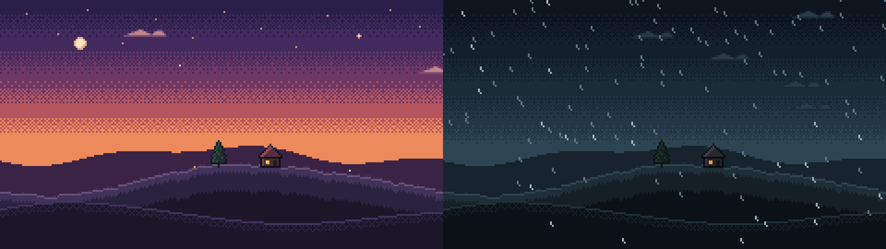

# pixel-loop

An agent skill for making **hand-crafted pixel-art loops with a generative lofi
soundtrack**: a scene that drifts through moods (seasons, dusk and night, weather)
while the music changes key, tempo and instruments with it and blends between them
like a DJ set. Picture and music loop exactly, so one short file can play for hours.


Every frame is drawn from hand-placed pixel maps and strict per-scene palettes:
no blur, no gradients, no filters. Motion is stepped like hand animation, and
season changes dissolve through an ordered dither. The soundtrack is synthesised in
the browser (Rhodes, guitar, felt piano, music box, pads, drums, rain, fire, vinyl),
so there are no samples and nothing to license.

**Outputs**
- **A live page:** one self-contained HTML file that plays forever with live generative music.
- **A crisp MP4:** 1080p or 4K, scaled by whole pixels with nearest neighbour, BT.709, H.264 with AAC 320k. It is one exact loop, ready to put on repeat for YouTube or social.

## Install

The skill is this folder (`SKILL.md` at the root).

- **Claude Code:** `git clone https://github.com/huiskylabs/pixel-loop ~/.claude/skills/pixel-loop`
- **Claude apps:** zip the folder and add it as a custom skill.
- **Other agents** that read `SKILL.md` skills: point them at the folder.

Then ask for something like *"make a pixel-art lofi loop of a lighthouse keeper's
cabin through a stormy night into a clear dawn, 4K for YouTube"*.

**Needs:** `node` 18+, `python3` with `pillow` and `numpy`, `ffmpeg` with libx264, and
Playwright Chromium (`pip install playwright && playwright install chromium`) for the
soundtrack.

## By hand

```sh
cp -r templates/starter my-scene                          # 240x135, two phases: dusk and rain
python3 tools/shot.py my-scene 10 40 --grid --zoom 4      # preview frames
python3 tools/check.py my-scene --page                    # palettes, timing, loop seam, page
python3 tools/build.py my-scene --release                 # my-scene/dist/hilltop-cabin.html
python3 tools/render_audio.py my-scene loop.wav           # one seamless loop of the music
python3 tools/render_video.py my-scene out.mp4 --audio loop.wav              # 1080p
python3 tools/render_video.py my-scene out-4k.mp4 --scale 16 --audio loop.wav  # 4K
```



## Layout

| path | what |
|---|---|
| `SKILL.md` | the workflow the agent follows |
| `references/` | scene contract and API, craft rules for a hand-made look, music guide |
| `engine/` | timeline, palette renderer, phase dissolve, soundtrack, page |
| `tools/` | build, preview, checks, sprite generation, audio and video export |
| `templates/starter/` | smallest complete scene to copy |
| `examples/lantern-isle/` | a full scene: an island cottage through four seasons |

## How the loop stays exact

- **Picture:** every frame is a pure function of its tick, and every animation period divides the loop length.
- **Music:** random choices are seeded per cycle, and ambience beds and tape wobble are fitted to a whole number of turns per loop.
- **Rendering:** the soundtrack is rendered with a pre-roll, and the tools verify the seam: audio after the loop must match its start below −60 dB, and the last frame must step into the first like any other frame.

## License

MIT. Made by Huisky Labs.
